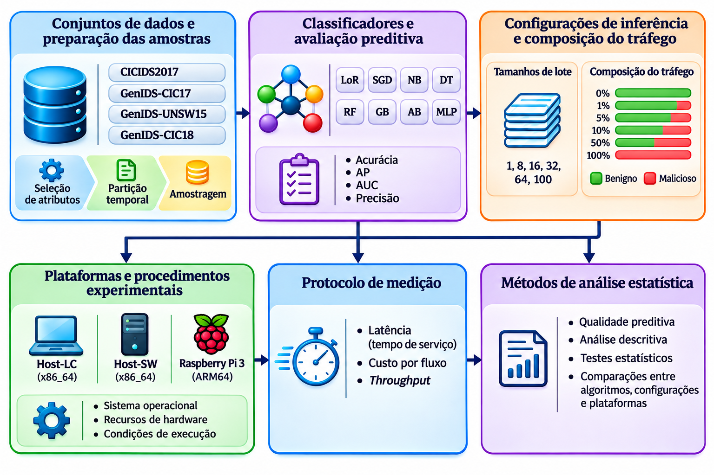
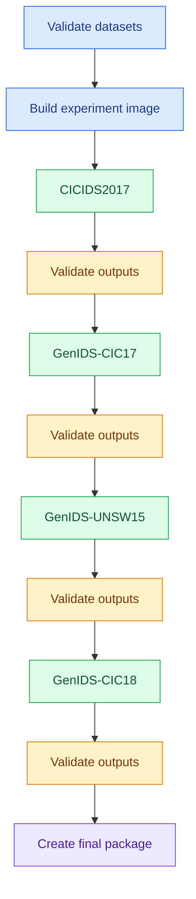
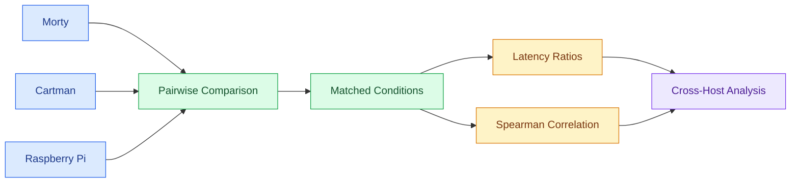
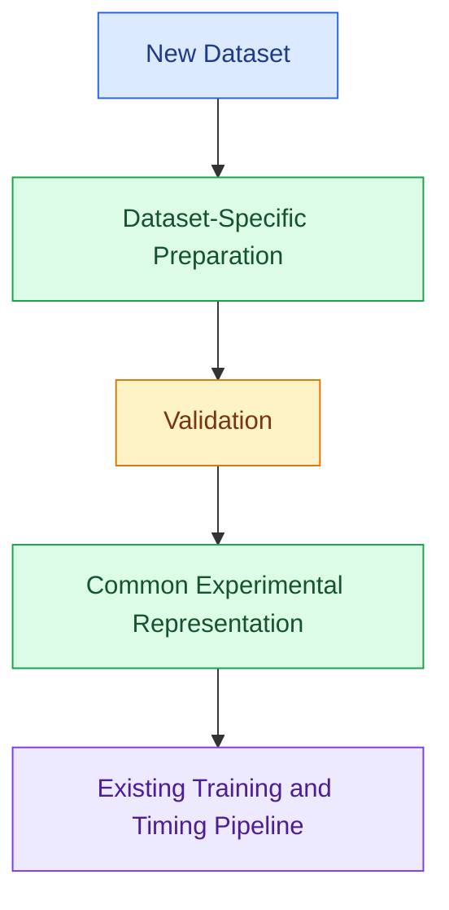

<a name="latency-aware-evaluation-of-flow-based-ml-ids"></a>

<h1 align="center">Latency-Aware Evaluation of Flow-Based ML-IDS</h1>

<p align="center">
  <strong>
    Predictive Quality · Inference Latency · Throughput · Cross-Host Reproducibility
  </strong>
</p>

<p align="center">
  A reproducible experimental artifact for flow-based Machine Learning Intrusion Detection Systems.
</p>

<p align="center">
  <a href="#datasets">
    
  </a>
  <a href="#machine-learning-models">
    
  </a>
  <a href="#experimental-design">
    
  </a>
  <a href="#experimental-design">
    
  </a>
  <a href="#experimental-design">
    
  </a>
  <a href="#execution-platforms-and-results">
    
  </a>
</p>

<p align="center">
  <a href="#experimental-design">
    
  </a>
</p>

<p align="center">
  <a href="#experimental-methodology">Methodology</a> ·
  <a href="#experimental-design">Design</a> ·
  <a href="#execution-platforms-and-results">Results</a> ·
  <a href="#reproduce-the-experiment">Reproduce</a> ·
  <a href="#post-hoc-cross-host-comparison">Cross-Host Analysis</a> ·
  <a href="PROTOCOL.md">Protocol</a> ·
  <a href="#citation">Citation</a>
</p>

---

## Overview

This repository provides a reproducible experimental artifact for evaluating predictive quality and inference performance in flow-based Machine Learning Intrusion Detection Systems (ML-IDS).

The study examines how model choice, inference granularity, traffic composition, and execution platform affect inference service time, amortized per-flow cost, and throughput.

## Experimental Methodology

<p align="center">
  
</p>

<p align="center">
  <em>Figure 1. Overview of the experimental methodology.</em>
</p>

The workflow comprises dataset-specific feature selection, temporal partitioning and sampling; training and predictive evaluation of eight classifiers; inference under varying batch sizes and malicious-flow fractions; controlled execution on three physical platforms; and statistical analysis of predictive and computational outcomes.

Predictive evaluation includes accuracy, average precision (AP), ROC-AUC, and precision.

---

## Experimental Design

<table>
  <tr>
    <td align="center" width="25%">
      <h2>4</h2>
      Datasets
    </td>
    <td align="center" width="25%">
      <h2>8</h2>
      ML Models
    </td>
    <td align="center" width="25%">
      <h2>36</h2>
      Inference Configurations per Model
    </td>
    <td align="center" width="25%">
      <h2>3</h2>
      Physical Hosts
    </td>
  </tr>
</table>

| Dimension | Configuration |
|:---|:---|
| Datasets | 4 |
| Models | 8 |
| Batch sizes | `1`, `8`, `16`, `32`, `64`, `100` |
| Requested malicious fractions | `0%`, `1%`, `5%`, `10%`, `50%`, `100%` |
| Repetitions per condition and process | 30 |
| Independent processes | 12 |
| Warm-up iterations | 20 |
| Physical hosts | 3 |
| Conditions per dataset | 288 |
| Timing observations per dataset and host | 103,680 |
| Timing observations per host | 414,720 |
| **Total timing observations** | **1,244,160** |

<details>
<summary><strong>Experimental scale calculation</strong></summary>

<br>

The number of timing observations per dataset and host is:

$$
8 \times 6 \times 6 \times 30 \times 12 = 103{,}680
$$

The complete four-dataset experiment on one host produces:

$$
103{,}680 \times 4 = 414{,}720
$$

Across the three physical hosts:

$$
414{,}720 \times 3 = 1{,}244{,}160
$$

Requested malicious fractions define the experimental conditions; their realization is constrained by integer batch sizes.

</details>

## Datasets

| Dataset | Description |
|:---|:---|
| **CICIDS2017** | Corrected version of CICIDS2017 |
| **GenIDS-CIC17** | GenIDS dataset associated with CICIDS2017 |
| **GenIDS-UNSW15** | GenIDS dataset associated with UNSW-NB15 |
| **GenIDS-CIC18** | GenIDS dataset associated with CICIDS2018 |

Dataset-specific preparation precedes the common training and timing pipeline.

On Raspberry Pi, GenIDS-CIC18 uses a memory-compatible [V2 subset](https://github.com/LeonelLucas/latency-ids/releases/tag/raspberry-datasets-v1.0); this input difference must be considered in cross-host comparisons.

## Machine Learning Models

Eight machine learning models are evaluated.

| Abbreviation | Machine Learning Model |
|:---:|:---|
| `LoR` | Logistic Regression |
| `SGD` | Stochastic Gradient Descent with Logistic Loss |
| `NB` | Gaussian Naive Bayes |
| `DT` | Decision Tree |
| `RF` | Random Forest |
| `GB` | Gradient Boosting |
| `AB` | AdaBoost |
| `MLP` | Multilayer Perceptron |

---

## Measurement Boundary and Metrics

> [!IMPORTANT]
> The benchmark measures model inference service time, not end-to-end IDS latency. Network capture, flow construction, and waiting for a batch to form are outside the measurement boundary.

For a batch of size $b$ with measured service time $L(b)$ in seconds:

| Metric | Definition | Unit |
|:---|:---:|:---|
| Inference latency | $L(b)$ | Seconds |
| Amortized per-flow cost | $L(b)/b$ | Seconds per flow |
| Throughput | $b/L(b)$ | Flows per second |

For $b=1$, call latency and per-flow cost coincide.

For larger batches, amortized cost is not the response time experienced by an individual flow.

Predictive quality and computational performance are evaluated separately.

---

## Execution Platforms and Results

<table>
  <tr>
    <td align="center" width="33%">
      <h3>Morty</h3>
      
      <br><br>
      <strong>Host-SW</strong>
      <br>
      Linux
      <br><br>
      <a href="multidataset-run-20260930T225117Z/">
        
      </a>
    </td>
    <td align="center" width="33%">
      <h3>Cartman</h3>
      
      <br><br>
      <strong>Host-LC</strong>
      <br>
      Intel Core i7-3770
      <br><br>
      <a href="multidataset-run-20261112T012654Z/">
        
      </a>
    </td>
    <td align="center" width="33%">
      <h3>Raspberry Pi</h3>
      
      <br><br>
      <strong>Embedded Platform</strong>
      <br>
      Raspberry Pi 3 Model B
      <br><br>
      <a href="multidataset-run-20261101T205354Z/">
        
      </a>
    </td>
  </tr>
</table>

Each host completed the four-dataset evaluation independently. Host labels describe execution contexts rather than hardware quality. Absolute timing values need not be identical across platforms.

### Explore Experimental Results

Select a dataset and execution platform to access the corresponding analysis directory.

| Dataset | Morty | Cartman | Raspberry Pi |
|:---|:---:|:---:|:---:|
| CICIDS2017 | [Analysis](multidataset-run-20260930T225117Z/results/cicids2017/analysis/) | [Analysis](multidataset-run-20261112T012654Z/results/cicids2017/analysis/) | [Analysis](multidataset-run-20261101T205354Z/results/cicids2017/analysis/) |
| GenIDS-CIC17 | [Analysis](multidataset-run-20260930T225117Z/results/genids_cic17/analysis/) | [Analysis](multidataset-run-20261112T012654Z/results/genids_cic17/analysis/) | [Analysis](multidataset-run-20261101T205354Z/results/genids_cic17/analysis/) |
| GenIDS-UNSW15 | [Analysis](multidataset-run-20260930T225117Z/results/genids_unsw15/analysis/) | [Analysis](multidataset-run-20261112T012654Z/results/genids_unsw15/analysis/) | [Analysis](multidataset-run-20261101T205354Z/results/genids_unsw15/analysis/) |
| GenIDS-CIC18 | [Analysis](multidataset-run-20260930T225117Z/results/genids_cic18/analysis/) | [Analysis](multidataset-run-20261112T012654Z/results/genids_cic18/analysis/) | [Analysis](multidataset-run-20261101T205354Z/results/genids_cic18/analysis/) |

<details>
<summary><strong>Original experimental run directories</strong></summary>

<br>

| Host | Original Run |
|:---|:---|
| Morty | [multidataset-run-20260930T225117Z](multidataset-run-20260930T225117Z/) |
| Cartman | [multidataset-run-20261112T012654Z](multidataset-run-20261112T012654Z/) |
| Raspberry Pi | [multidataset-run-20261101T205354Z](multidataset-run-20261101T205354Z/) |

Each directory preserves its corresponding experimental results, host metadata, and execution logs.

</details>

---

## Reproduce the Experiment

Start with the [experimental protocol](PROTOCOL.md) and select the appropriate runner for your platform.

### Requirements

<p>
  
  
  
  
</p>

The definitive experiment requires a Linux execution environment with Docker and the host-level interfaces required by the experimental controls.

Important host-side dependencies include:

- Linux
- Docker
- Bash
- Python 3
- `taskset`
- Standard GNU/Linux command-line utilities

The benchmark environment itself is built and executed according to the repository configuration.

The definitive runner performs additional validation before benchmark execution and stops when mandatory experimental requirements are not satisfied.

### Clone the Repository

```bash
git clone -b genids-experiments https://github.com/LeonelLucas/latency-ids.git

cd latency-ids
```

### Dataset Availability

Before starting the multi-dataset runner, make the required source datasets available in the expected locations.

The individual Raspberry Pi runners automate acquisition and integrity verification.

Consult the dataset preparation scripts and [configuration files](configs/) for the required source organization.

### Definitive Experiment Runner

The complete multi-dataset experiment on one physical host is executed with:

```bash
./run_all_datasets_definitive.sh
```

The runner validates the required inputs and executes the complete four-dataset workflow.



> [!NOTE]
> The definitive runner does not automatically perform cross-host comparison.

The experiment should be executed from the repository root using the frozen experimental version documented for the corresponding run.

A definitive execution should be allowed to complete without modifying the experimental code or configuration during the run.

Each physical host performs its own independent complete execution.

### Individual Dataset Runners for Raspberry Pi

The scripts in [`runners_raspberry/`](runners_raspberry/) allow each dataset to be executed independently, including automatic dataset acquisition, integrity verification, preparation, training, benchmarking, analysis, and validation.

<details>
<summary><strong>CICIDS2017</strong></summary>

<br>

```bash
bash runners_raspberry/run_cicids2017.sh
```

[View runner source](runners_raspberry/run_cicids2017.sh)

</details>

<details>
<summary><strong>GenIDS-CIC17</strong></summary>

<br>

```bash
bash runners_raspberry/run_genids_cic17.sh
```

[View runner source](runners_raspberry/run_genids_cic17.sh)

</details>

<details>
<summary><strong>GenIDS-UNSW15</strong></summary>

<br>

```bash
bash runners_raspberry/run_genids_unsw15.sh
```

[View runner source](runners_raspberry/run_genids_unsw15.sh)

</details>

<details>
<summary><strong>GenIDS-CIC18</strong></summary>

<br>

```bash
bash runners_raspberry/run_genids_cic18.sh
```

[View runner source](runners_raspberry/run_genids_cic18.sh)

</details>

<details>
<summary><strong>Raspberry Pi execution requirements</strong></summary>

<br>

The runners require:

- ARM64 Linux.
- Docker with the `latency-ids:raspberry-pi` image.
- Adequate swap.
- Stable power supply.
- Appropriate cooling.
- The `performance` CPU governor.

Benchmark execution uses CPU 3 and one computational thread.

The original Raspberry Pi runs were completed and validated; the later automated runners have not been fully re-executed end to end.

</details>

---

## Experimental Controls

The definitive runner performs host checks and records execution metadata to improve the reproducibility and auditability of the experiment.

| Control | Configuration |
|:---|:---|
| CPU selection | Explicit benchmark CPU |
| CPU governor | `performance` |
| Maximum one-minute load average | `0.50` |
| Cooldown between datasets | `30 seconds` |
| Host monitoring | Periodic execution-state capture |
| Execution metadata | Preserved per dataset |
| Result validation | Per dataset |
| Integrity verification | SHA-256 |

<details>
<summary><strong>Controlled Host Execution</strong></summary>

<br>

The controls include:

- Explicit CPU selection.
- CPU availability verification.
- CPU governor verification.
- Host-load checks before benchmarking.
- Host monitoring during benchmark execution.
- Cooldown periods between dataset executions.
- Execution-environment capture.
- Dataset-specific logs.
- Result validation.
- Artifact packaging.
- SHA-256 integrity verification.

### CPU Governor

The selected benchmark CPU is required to use the `performance` governor.

The runner checks this requirement before the definitive experiment continues.

### Quiet-Host Gate

Before benchmark execution, the runner checks the host load.

The default maximum accepted one-minute load average is `0.50`.

If the host exceeds this threshold, the runner waits for the load to fall within the accepted range before continuing, subject to the configured waiting period.

### Host Monitoring

During benchmark execution, host information is periodically recorded.

The monitoring infrastructure records system load and, when available, selected CPU frequency and thermal information.

The monitoring process is kept separate from the selected benchmark CPU when the host configuration permits it.

### Cooldown Between Datasets

The four datasets are executed sequentially.

A cooldown interval is used between dataset executions to reduce the risk that the immediately preceding experiment influences the next one through transient host state.

The default configured cooldown interval is `30 seconds`.

</details>

---

## Output Organization

Each definitive host execution creates an independent run directory.

```text
multidataset-run-<timestamp>/
├── results/
│   ├── cicids2017/
│   ├── genids_cic17/
│   ├── genids_unsw15/
│   └── genids_cic18/
├── host/
│   ├── cicids2017/
│   ├── genids_cic17/
│   ├── genids_unsw15/
│   └── genids_cic18/
└── logs/
    ├── cicids2017/
    ├── genids_cic17/
    ├── genids_unsw15/
    └── genids_cic18/
```

This organization keeps benchmark results, host information, and execution logs separated by dataset.

<details>
<summary><strong>Dataset Results</strong></summary>

<br>

Each dataset has its own result directory under:

```text
results/<dataset>/
```

The result directory contains the artifacts generated by the dataset-specific experiment and subsequent analysis.

A particularly important file for post-hoc cross-host comparison is:

```text
results/<dataset>/analysis/timing_summary.csv
```

This file contains the timing summary used to match equivalent experimental conditions between two physical hosts.

The required timing summaries are:

```text
results/cicids2017/analysis/timing_summary.csv
results/genids_cic17/analysis/timing_summary.csv
results/genids_unsw15/analysis/timing_summary.csv
results/genids_cic18/analysis/timing_summary.csv
```

</details>

<details>
<summary><strong>Host Information</strong></summary>

<br>

Host-specific information is stored separately under:

```text
host/<dataset>/
```

This directory preserves information collected around each dataset execution, including the quiet-host check, benchmark monitoring, and host-state captures.

Examples include:

```text
quiet_host_check.txt
benchmark_monitor.csv
monitor_affinity.txt
host_<phase>.txt
```

The exact host information available may depend on the operating system and hardware interfaces exposed by the machine.

</details>

<details>
<summary><strong>Execution Logs</strong></summary>

<br>

Dataset-specific execution logs are stored under:

```text
logs/<dataset>/
```

Keeping logs separated by dataset simplifies inspection of the complete multi-dataset execution and helps identify the stage associated with a particular message or failure.

</details>

<details>
<summary><strong>Final Result Package and Integrity Verification</strong></summary>

<br>

After all four datasets have completed successfully, the definitive runner creates a final result package.

The package preserves experimental results, analysis outputs, host information, logs, and a snapshot of the relevant experimental infrastructure.

A compressed archive is generated in the form:

```text
multidataset-results-<timestamp>.tar.gz
```

A corresponding SHA-256 checksum file is also generated:

```text
multidataset-results-<timestamp>.tar.gz.sha256
```

The checksum can be verified with:

```bash
sha256sum -c multidataset-results-<timestamp>.tar.gz.sha256
```

A successful verification should report:

```text
OK
```

This provides an integrity check for transferring or archiving the complete host execution.

</details>

<details>
<summary><strong>Artifact Snapshot</strong></summary>

<br>

The final package includes a snapshot of the experimental infrastructure used for the execution.

Reproducibility depends not only on preserving numerical results, but also on preserving the code and configuration associated with those results.

The snapshot includes the relevant experiment implementation and supporting scripts available at packaging time.

The package also contains SHA-256 hashes for its internal files, allowing the preserved artifact contents to be checked for integrity.

</details>

---

## Post-Hoc Cross-Host Comparison

The repository provides a dedicated wrapper for comparing two complete host executions:

[`compare_two_hosts.sh`](compare_two_hosts.sh)

The comparison is intentionally invoked manually after the two host result directories are available.



### General Usage

```bash
./compare_two_hosts.sh HOST_A_RUN HOST_B_RUN [OUTPUT_DIR]
```

For example:

```bash
./compare_two_hosts.sh \
    /path/to/host-a/multidataset-run-<timestamp> \
    /path/to/host-b/multidataset-run-<timestamp> \
    ./cross-host-analysis
```

| Argument | Description |
|:---|:---|
| `HOST_A_RUN` | Complete run directory produced by the first physical host |
| `HOST_B_RUN` | Complete run directory produced by the second physical host |
| `OUTPUT_DIR` | Optional output directory for the cross-host analysis |

If an explicit output directory is not supplied, the wrapper creates a timestamped cross-host analysis directory.

### Comparing the Three Hosts

The wrapper operates on two hosts at a time.

From the repository root, the original run directories can be assigned as follows:

```bash
MORTY="multidataset-run-20260930T225117Z"

CARTMAN="multidataset-run-20261112T012654Z"

RASPBERRY="multidataset-run-20261101T205354Z"
```

<details>
<summary><strong>Morty vs. Cartman</strong></summary>

<br>

```bash
./compare_two_hosts.sh \
    "$MORTY" \
    "$CARTMAN" \
    cross-host-analysis-morty-vs-cartman
```

</details>

<details>
<summary><strong>Morty vs. Raspberry Pi</strong></summary>

<br>

```bash
./compare_two_hosts.sh \
    "$MORTY" \
    "$RASPBERRY" \
    cross-host-analysis-morty-vs-raspberry
```

</details>

<details>
<summary><strong>Cartman vs. Raspberry Pi</strong></summary>

<br>

```bash
./compare_two_hosts.sh \
    "$CARTMAN" \
    "$RASPBERRY" \
    cross-host-analysis-cartman-vs-raspberry
```

</details>

> [!NOTE]
> These commands describe the comparison workflow, not a claim that all three pairwise analyses have already been completed.

### Cross-Host Experimental Scale

| Comparison Level | Matched Conditions |
|:---|---:|
| Per dataset and host pair | 288 |
| Across four datasets per host pair | 1,152 |
| Across three host pairs | 3,456 |

These values represent matched-condition comparisons, not additional timing observations.

<details>
<summary><strong>Cross-Host Validation</strong></summary>

<br>

Before performing the comparison, the wrapper checks whether both host executions contain the required timing summary for every dataset:

- CICIDS2017
- GenIDS-CIC17
- GenIDS-UNSW15
- GenIDS-CIC18

For each dataset, both hosts must contain:

```text
results/<dataset>/analysis/timing_summary.csv
```

The comparison stops if a required timing summary is missing.

This prevents a partial host execution from being silently treated as a complete four-dataset replication.

</details>

<details>
<summary><strong>Cross-Host Output</strong></summary>

<br>

The complete post-hoc analysis produces dataset-level comparisons and an aggregate four-dataset summary.

For each dataset, equivalent experimental conditions from Host A and Host B are matched and compared.

The aggregate comparison contains one summary entry for each of the four datasets and reports the number of matched conditions together with the cross-host statistics.

Cross-host outputs include the statistics required to inspect absolute latency differences and rank consistency between the two execution environments.

The detailed comparison infrastructure is implemented by:

- [`scripts/compare_hosts.py`](scripts/compare_hosts.py)
- [`scripts/compare_all_hosts.py`](scripts/compare_all_hosts.py)

The shell wrapper [`compare_two_hosts.sh`](compare_two_hosts.sh) provides the normal user-facing entry point for the complete post-hoc comparison.

</details>

<details>
<summary><strong>Cross-Host Statistics and Interpretation</strong></summary>

<br>

The post-hoc comparison evaluates both absolute timing differences and rank consistency.

### Latency Ratios

Latency ratios describe the relative execution speed of equivalent conditions on the two hosts.

These ratios characterize differences in absolute timing between the physical systems.

### Cross-Host Spearman Rank Correlation

For the post-hoc cross-host comparison, Spearman rank correlation evaluates whether the relative ordering of matched experimental conditions remains consistent across two physical hosts.

This cross-host statistic is distinct from the separate tree-path Spearman analysis described in the experimental protocol.

The tree-path analysis investigates the relationship between tree-path behavior and latency, whereas the cross-host statistic evaluates rank consistency between equivalent conditions executed on different hosts.

Two hosts may therefore have different absolute latencies while still producing very similar rankings among models and experimental configurations.

High cross-host rank consistency must not be interpreted as evidence that the hosts have identical absolute performance.

</details>

---

## Repository Entry Points

| Resource | Purpose |
|:---|:---|
| [Definitive Experiment Runner](run_all_datasets_definitive.sh) | Executes the complete four-dataset experiment on one host |
| [Raspberry Pi Runners](runners_raspberry/) | Executes individual datasets on Raspberry Pi |
| [Cross-Host Comparison](compare_two_hosts.sh) | Compares two complete physical-host executions |
| [Multi-Dataset Comparison](scripts/compare_all_hosts.py) | Coordinates cross-host comparison across all four datasets |
| [Statistical Comparison](scripts/compare_hosts.py) | Performs matched-condition cross-host statistical comparison |
| [Configurations](configs/) | Dataset-specific experimental configurations |
| [Experimental Implementation](latency_artifact/) | Core experimental components |
| [Experimental Protocol](PROTOCOL.md) | Detailed experimental methodology |
| [Dockerfile](Dockerfile) | Container environment definition |
| [Requirements](requirements.txt) | Software dependencies |

The dataset preparation and experiment implementation are contained in the corresponding repository scripts and `latency_artifact` components.

<details>
<summary><strong>Repository Structure</strong></summary>

<br>

```text
latency-ids/
├── configs/
├── docs/
│   └── images/
│       └── metodologia.png
├── latency_artifact/
├── results/
├── scripts/
├── runners_raspberry/
├── multidataset-run-20260930T225117Z/
├── multidataset-run-20261112T012654Z/
├── multidataset-run-20261101T205354Z/
├── CITATION.cff
├── Dockerfile
├── LICENSE
├── Makefile
├── PROTOCOL.md
├── README.md
├── compare_two_hosts.sh
├── compose.yaml
├── requirements.txt
└── run_all_datasets_definitive.sh
```

The repository separates experimental implementation, configuration, documentation, execution scripts, and generated results.

The exact contents of generated result directories depend on the execution stage and dataset, while the definitive runner maintains a common high-level organization for all four datasets.

</details>

---

## Protocol Documentation

<p align="center">
  <a href="PROTOCOL.md">
    
  </a>
</p>

The detailed experimental protocol is documented in [`PROTOCOL.md`](PROTOCOL.md).

The README provides the high-level description and reproduction workflow, while the protocol documents the detailed experimental methodology, measurement design, controls, and analysis rules.

When reproducing or extending the experiment, the protocol should be considered together with the frozen implementation used to generate the corresponding results.

---

## Extending the Experiment

<details>
<summary><strong>Integrating Additional Datasets</strong></summary>

<br>

The repository is structured so that additional datasets can be integrated while preserving a common experimental methodology.

A new dataset should not simply be passed directly to the benchmark without considering its schema and semantics.

Instead, integration should preserve the separation:



Any extension should document changes to preprocessing, feature selection, labeling, sampling, model configuration, timing methodology, or host controls.

Results produced under a modified protocol should be clearly distinguished from results produced by the definitive configuration documented in this repository.

</details>

<details>
<summary><strong>Result Preservation</strong></summary>

<br>

For reproducibility, the complete output of each physical-host execution should be preserved.

In particular, retain:

- The complete run directory.
- The generated result package.
- The SHA-256 checksum file.
- Host metadata.
- Benchmark monitoring data.
- Execution logs.
- Analysis outputs.
- The corresponding repository revision.

All three host executions should remain identifiable as independent experimental runs.

Cross-host analysis outputs should also be preserved separately rather than replacing either host's original measurements.

</details>

---

## Reproducibility Checklist

<details>
<summary><strong>Host Execution Checklist</strong></summary>

<br>

Before considering a host execution complete, verify that:

- [ ] All four datasets were evaluated.
- [ ] The selected runners completed successfully.
- [ ] The expected dataset-level analyses were generated.
- [ ] Host metadata was preserved.
- [ ] Benchmark monitoring information was preserved.
- [ ] The final package was created, where applicable.
- [ ] The package checksum verifies successfully, where applicable.
- [ ] The repository revision associated with the execution is known.

</details>

<details>
<summary><strong>Cross-Host Comparison Checklist</strong></summary>

<br>

Before performing the cross-host comparison, verify that:

- [ ] Both physical-host executions are complete.
- [ ] Both executions correspond to the intended experimental methodology.
- [ ] All four `timing_summary.csv` files exist for each host.
- [ ] The original host results remain unchanged.

After the comparison, preserve the generated cross-host analysis alongside the independent host artifacts.

</details>

---

## Citation

If this repository or its experimental artifacts are used in academic work, please cite the corresponding research work and use the repository citation metadata when applicable.

<p>
  <a href="CITATION.cff">
    
  </a>
</p>

When reporting experimental results, the repository revision and the corresponding preserved experimental artifacts should also be recorded whenever possible.

## License

See [`LICENSE`](LICENSE) for the licensing terms applicable to this repository.

---

<p align="center">
  <strong>Latency-Aware Evaluation of Flow-Based ML-IDS</strong>
</p>

<p align="center">
  Reproducible Experiments · Predictive Evaluation · Inference Performance
</p>

<p align="center">
  <a href="#latency-aware-evaluation-of-flow-based-ml-ids">Back to top ↑</a>
</p>
